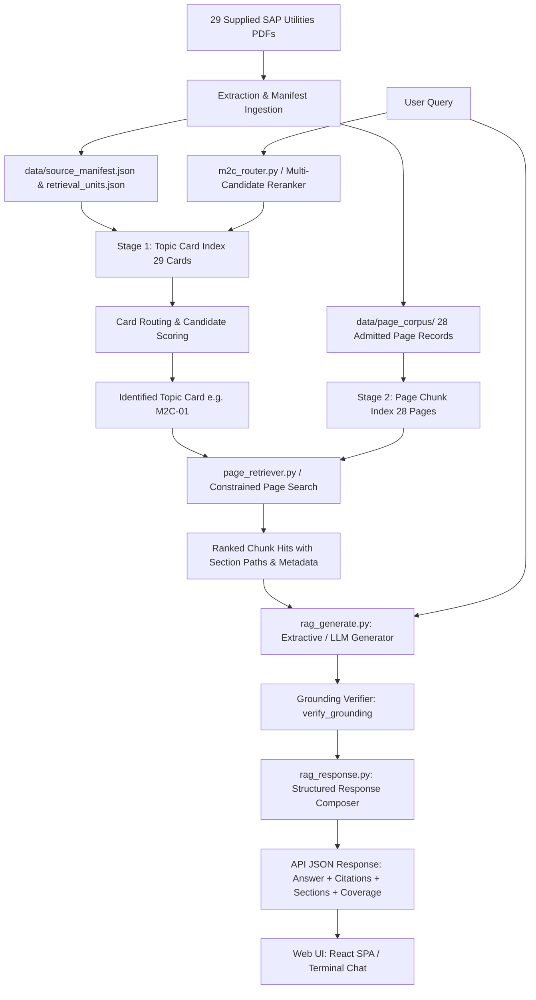

# SURA SAP Utilities RAG Chatbot — Operating Manual & Architecture Guide

## 1. Overview & Objective
SURA is a production-grade, document-grounded Retrieval-Augmented Generation (RAG) system specifically designed for SAP S/4HANA Utilities (Meter-to-Cash, Master Data, Billing, Invoicing, FI-CA, Device Management, and Customer Service).

The system operates strictly on authoritative source documentation (29 supplied SAP Utilities reference documents and 28 admitted Help Portal topic pages). It guarantees that answers are grounded directly in the text with explicit source citations (`[S#]`), preventing hallucinations of transaction codes, configuration steps, or unsupported assertions.

---

## 2. End-to-End Architecture & Data Flow



### Components
1. **Source Corpus & Manifest**:
   - `data/source_manifest.json`: Exact registry of all 29 supplied PDF documents (`01_Utilities_Master_Data.pdf` through `29_Disconnection_Reconnection_of_a_Utility_Installation.pdf`) with page counts, SHA-256 hashes, and extraction status.
   - `data/retrieval_units.json`: 29 structured M2C topic cards with title, category, authoritative SAP Help URL, and embedding text.
   - `data/page_corpus/`: 28 admitted SAP Help pages in clean, normalized JSON format (`M2C-18` remains intentionally unadmitted due to conflicting deliverable mapping).
2. **Two-Stage Hierarchical Retrieval**:
   - **Stage 1 (Topic Card Routing)**: `scripts/m2c_router.py` maps user queries to the most relevant SAP Utilities topic card. Uses cosine similarity and discriminative phrase boosting.
   - **Multi-Candidate Reranker**: `scripts/phase13_reranker.py` evaluates candidate topic cards against page retrieval evidence, penalizing unadmitted identity cards.
   - **Stage 2 (Identity-Constrained Page Search)**: `scripts/page_retriever.py` searches only within the identified page's chunks, preventing cross-topic leakage.
3. **Grounding & Answer Generation**:
   - `scripts/rag_generate.py`: Extractive generator extracts verbatim sentences matching retrieved chunks. Enforces citation tags (`[S1]`, `[S2]`).
   - `verify_grounding()`: Strict validator that rejects responses with phantom citations, unreferenced sources, or synthesized transaction codes not present in the retrieved chunks.
   - `scripts/rag_response.py`: Composes deterministic structured answers with Overview, Key Details, Summary, and explicit Citations.
4. **Service & API**:
   - `scripts/ephemeral_service.py`: Safe in-memory service factory using Chroma's `EphemeralClient`. Guarantees zero contact with protected SQLite databases.
   - `scripts/rag_api.py`: FastAPI server serving `/health`, `/ready`, `/api/health`, `/api/chat`, and hosting the pre-built React chat UI from `web/dist`.

---

## 3. Data & Repository Safeguards

The repository enforces strict safety rules:
- **Protected Vector Stores**:
  - `data/vector_store/chroma.sqlite3`
  - `data/vector_store/page_collection/chroma.sqlite3`
  - These databases are immutable release artifacts and are never opened, modified, or migrated during local development or test runs.
- **Delivery Manifest Protection**:
  - `release/evidence_closure_v3/delivery-inputs.sha256` pins all 979 inherited tracked files. Verified via `python release/evidence_closure_v3/verify_delivery_inputs.py`.
- **Release Gate Separation**:
  - Development readiness (functional in-memory development server and test suite) is decoupled from formal production release approval (which requires external signed prerequisite evidence for Gates 1–5).

---

## 4. How to Run the Development Chatbot

### Option A: Interactive Terminal Chat
Launch a standalone interactive chat session in your terminal:
```powershell
python scripts/ephemeral_service.py --chat
```
- Indexes all 29 topic cards and 28 admitted page documents in-memory.
- Submit SAP Utilities questions (e.g., master data, meter reading estimation, installment plans).
- Responses include grounded answers, cited source links, and available section breakdowns.
- Type `exit` or `quit` to exit.

### Option B: Local Web Server & REST API
Start the FastAPI backend and web interface:
```powershell
python scripts/ephemeral_service.py --serve --port 8000
```
- Open your browser to `http://127.0.0.1:8000/`.
- Serves the compiled React UI (`web/dist/index.html`) directly.
- Exposes API endpoints:
  - `GET /health`: Liveness probe (`{"status": "ok", "process": "live"}`).
  - `GET /ready`: Readiness probe verifying 29 topics and 28 admitted pages.
  - `POST /api/chat`: Grounded chat endpoint (`{"message": "..."}`).

---

## 5. How to Run the Verification and Test Suite

### Safe Test Execution
Run the comprehensive suite of 94 tests verifying RAG pipeline, API, intake validator, delivery manifest, response composer, and Windows portability:
```powershell
python -m pytest tests/test_ephemeral_rag_pipeline.py tests/test_intake_validator.py tests/test_delivery_inputs_verifier.py tests/test_rag_response.py tests/test_windows_portability.py -v
```
**Current Result**: 94 passed, 4 subtests passed, 0 failed.

### Verify Tracked Delivery Files (979 files)
```powershell
python release/evidence_closure_v3/verify_delivery_inputs.py
```
**Output**: `979 inherited tracked files match published delivery (exact set equality verified)`.

### Validate External Release Intake Gates
```powershell
python release_intake/validate_intake.py
```
**Current Result**: Exits with code 1; correctly reports Gates 1–5 as MISSING and Gate 6 as BLOCKED until prerequisite evidence is received.

---

## 6. Production Release Gates & Prerequisites Tracker

| Gate | Title | Deliverable Required | Responsible Role | Status |
|---|---|---|---|---|
| **Gate 1** | Model Provenance | 13-file model export and signed inventory for `gt_all_minilm_l6_v2` | Model Custodian / ML Ops | **MISSING** (Ready for external transmission) |
| **Gate 2** | Cold-Store Snapshots | Authorized cold-store bundle and signed physical checksums | Infrastructure / DBA Owner | **MISSING** (Ready for external transmission) |
| **Gate 3** | Windows Runtime | Approved Windows dependencies and runtime binary verification | Windows Release Lead | **MISSING** (Ready for external transmission) |
| **Gate 4** | SAP Review | Independent expert review of the 184-row SAP Utilities QA worksheet | Principal SAP Utilities SME | **MISSING** (Ready for external transmission) |
| **Gate 5** | Security Decisions | Authorized security sign-off on CORS, profile bindings, and auth | AppSec / Security Approver | **MISSING** (Ready for external transmission) |
| **Gate 6** | Strict 113-Query Evaluation | Full automated evaluation report | System Coordinator | **BLOCKED** by Gates 1–5 |

Request packages and verification checklists are maintained in `SURA_EXTERNAL_OWNER_REQUEST_PACKAGE_DRAFT_2026-10-15.md` and `release_intake/NEXT_HANDOFF.md`.
